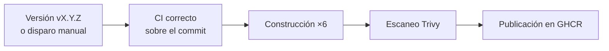
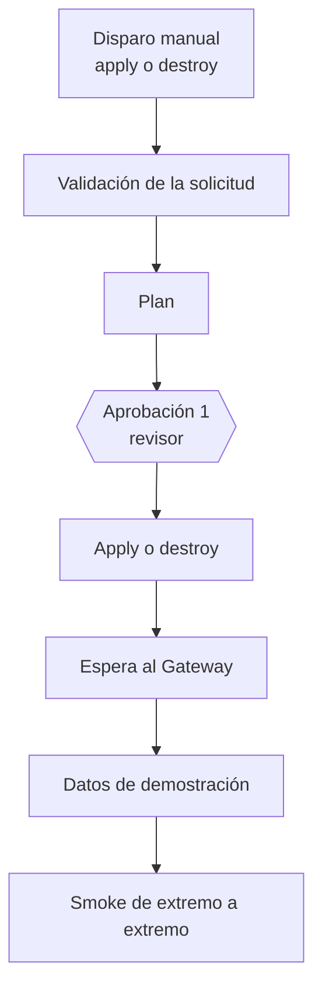

# Automatización de despliegues de ColdGuard

El despliegue a Azure se automatiza con dos flujos de GitHub Actions. Ninguno corre solo: la
publicación de imágenes se dispara al crear una versión y el flujo de Azure solo se ejecuta a mano y
después de que una persona lo apruebe.

**Estado:** los flujos están escritos y verificados con las herramientas de análisis (sintaxis y
buenas prácticas). Todavía no se han ejecutado contra Azure; la evidencia de la primera ejecución se
añade a este documento cuando exista.

## 1. Flujo de publicación de imágenes

| Paso | Qué hace |
|---|---|
| Compuerta | Exige una ejecución de CI correcta sobre el mismo commit; si no existe, no publica |
| Construcción | Las seis imágenes (cinco servicios y el simulador), con la etiqueta del commit y su origen en las etiquetas OCI |
| Escaneo | Trivy falla ante vulnerabilidades **críticas con parche disponible**; las excepciones se documentan una a una |
| Publicación | Etiqueta inmutable `sha-<commit>` y, para versiones, `vX.Y.Z`. Nunca `latest` |

El registro es GitHub Container Registry con paquetes públicos: es gratuito, el repositorio ya es
público y las imágenes no contienen secretos (se leen de Key Vault al ejecutar).

## 2. Flujo del entorno Azure

- **Validación:** comprueba que las variables de la federación existan y que las cinco imágenes de la
  etiqueta pedida se puedan descargar.
- **Plan y cambio:** son dos trabajos distintos, cada uno bajo el *environment* protegido `azure-dev`
  con revisor obligatorio. El revisor aprueba, lee el resumen del plan y aprueba de nuevo antes de
  que se modifique algo.
- **Autenticación:** OIDC con una identidad administrada federada; no existe ningún secreto de
  larga vida. La credencial solo es válida para trabajos que se ejecutan bajo ese *environment*, así
  que los pull requests no pueden tocar Azure.
- **Concurrencia:** un solo cambio a la vez; una operación en curso nunca se cancela.
- **Después del apply:** espera hasta 15 minutos a que el Gateway responda, siembra los datos y ejecuta
  el recorrido completo (13 comprobaciones; los correos se omiten porque en Azure Mailpit solo
  expone SMTP). El resumen avisa de que el entorno sigue encendido y cuesta dinero hasta destruirlo.

### Simulador de sensores en Azure

El simulador se despliega apagado junto con el entorno. Su escenario necesita los identificadores de
los sensores, que se crean al sembrar los datos, así que no puede conocerse al aplicar la
infraestructura. Un tercer flujo manual, también bajo el *environment* `azure-dev`, lo gobierna:

- **Iniciar:** siembra los datos (es idempotente), genera la línea de tiempo de demostración con los
  identificadores reales y se la entrega al simulador. Eso crea una revisión nueva, de modo que el
  reloj del escenario empieza en cero: se ejecuta cuando arranca la demostración. Los incidentes
  aparecen en unos 4 minutos.
- **Detener:** apaga el simulador sin destruir el entorno.

## 3. Versionado y rollback

| Concepto | Regla |
|---|---|
| Etiqueta de desarrollo | `sha-` y los 12 primeros caracteres del commit |
| Etiqueta de versión | `vX.Y.Z` (v0.3 para APF3, v1.0 para la entrega final) |
| Etiqueta prohibida | `latest`: la configuración de Terraform la rechaza |
| Rollback | Nuevo `apply` con la etiqueta anterior; Container Apps crea una revisión nueva y la anterior queda en el historial |
| Cambio asociado | Todo despliegue y todo `destroy` se registran como cambio de infraestructura |

## 4. Variables que debe crear una persona

Se guardan como variables del repositorio (no son secretos) y el *environment* `azure-dev` con un
revisor requerido:

| Variable | Contenido |
|---|---|
| `AZURE_CLIENT_ID` | Identificador de cliente de la identidad federada |
| `AZURE_TENANT_ID` | Identificador del tenant |
| `AZURE_SUBSCRIPTION_ID` | Identificador de la suscripción |
| `AZURE_OWNER` | Alias del responsable, usado en la etiqueta `owner` |
| `TF_STATE_RESOURCE_GROUP` | Grupo de recursos del estado de Terraform |
| `TF_STATE_STORAGE_ACCOUNT` | Cuenta de almacenamiento del estado |

## 5. Límites

- Sin una suscripción aprovisionada no se puede probar el flujo de Azure de extremo a extremo; lo
  verificable sin ella (sintaxis, validación de Terraform y construcción de imágenes) se comprueba en
  cada cambio.
- La segunda aprobación vuelve a planificar antes de aplicar, de modo que el cambio ejecutado puede
  diferir del plan leído si la infraestructura cambió entre ambos pasos; el plazo entre ellos es de
  minutos.
- El rollback no es automático: requiere un nuevo despliegue con aprobación.
