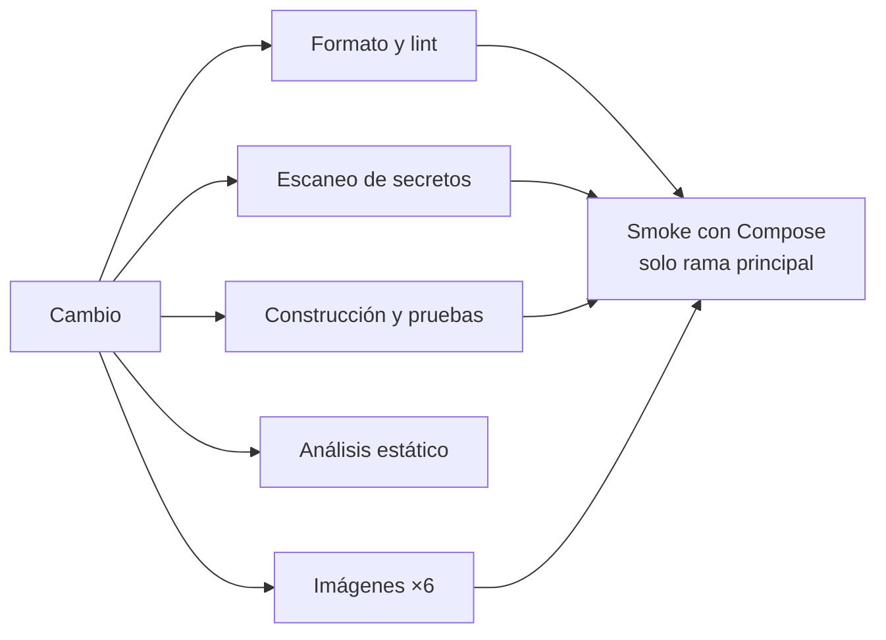

# Pipeline de integración continua de ColdGuard

El pipeline de integración continua (CI) verifica automáticamente cada cambio antes de integrarlo a
la rama principal. Está implementado con GitHub Actions y hace cumplir los criterios de calidad del
proyecto: compilación con Java 25, formato, pruebas unitarias y de integración, análisis estático,
ausencia de secretos, imágenes de contenedor construibles y un recorrido de extremo a extremo con
Docker Compose.

## 1. Cuándo se ejecuta

| Evento | Qué corre |
|---|---|
| Solicitud de integración (pull request) | Formato y lint, escaneo de secretos, construcción y pruebas, análisis estático y construcción de las seis imágenes |
| Integración a la rama principal | Todo lo anterior, más el recorrido de extremo a extremo (smoke) con Docker Compose |
| Ejecución manual | Igual que en la rama principal |

Una ejecución nueva sobre la misma solicitud cancela la anterior; sobre la rama principal nunca se
cancela. Los permisos del flujo son de solo lectura y no necesita ningún secreto: las pruebas usan las
credenciales de desarrollo del entorno local.

## 2. Etapas y criterios de calidad

| Etapa | Qué verifica | Herramienta (versión fijada) |
|---|---|---|
| Formato y lint | Formato Java; sintaxis y tipos de los flujos de trabajo; buenas prácticas en los Dockerfile; errores en los scripts de shell | Spotless con google-java-format; actionlint 1.7.7; hadolint 2.12.0; shellcheck 0.10.0 |
| Escaneo de secretos | Credenciales en todo el historial de Git, no solo en el último cambio | gitleaks 8.21.2 |
| Construcción y pruebas | Compilación con Java 25 (Temurin) de los siete módulos; pruebas unitarias, de integración (PostgreSQL, RabbitMQ y mTLS reales con contenedores de prueba) y de contrato; resumen por módulo y reportes como artefacto | Maven, JUnit 5, Testcontainers |
| Análisis estático | Defectos de código en los siete módulos | SpotBugs 4.9.8.2, umbral Medio |
| Imágenes | Las seis imágenes (cinco servicios y el simulador) se construyen y arrancan un entorno Java 25. En CI nunca se publican | Docker |
| Smoke con Compose | Se levanta toda la plataforma desde cero, se siembran datos de demostración y se recorre el flujo completo: login por rol, lectura fuera de rango, incidente, reconocimiento, escalamiento, correo, cierre, auditoría y métricas (13 comprobaciones) | Docker Compose y scripts del proyecto |

Las herramientas externas se ejecutan como imágenes de contenedor con versión fija y las acciones de
GitHub se fijan por el hash de su commit, para que un cambio ajeno al proyecto no altere el resultado.

### Excepciones documentadas

Cada excepción es acotada y tiene una razón; ninguna desactiva un control completo.

| Control | Excepción | Razón |
|---|---|---|
| hadolint | No exige fijar la versión de `curl` instalado desde el sistema base | La versión del repositorio del sistema cambia con cada actualización y rompería la construcción |
| SpotBugs | Patrones de exposición de representación interna al recibir colaboradores por constructor | Es la inyección de dependencias de Spring: guardar la dependencia es el diseño |
| SpotBugs | Excepción lanzada desde un constructor | Los constructores validan la configuración y fallan al arrancar a propósito |
| SpotBugs | Clases generadas por protoc | No es código escrito a mano |
| gitleaks | Una contraseña ficticia en una prueba | La prueba verifica que esa contraseña nunca llegue a los registros |

## 3. Análisis de dependencias

Dependabot propone cada semana actualizaciones de las dependencias Maven, de las acciones de GitHub y
de las imágenes base de los seis Dockerfile. Se descartó OWASP Dependency-Check porque exige una clave
de la base de vulnerabilidades NVD y alarga mucho la ejecución.

## 4. Cómo reproducir cada control en una máquina local

| Control | Comando |
|---|---|
| Formato | `mvn spotless:check` (corrige con `mvn spotless:apply`) |
| Construcción y pruebas | Generar los certificados de desarrollo y ejecutar `mvn verify` |
| Análisis estático | `mvn package` seguido del objetivo `check` de SpotBugs con el filtro de exclusiones del proyecto |
| Flujos, Dockerfile y scripts | actionlint, hadolint y shellcheck en sus imágenes de contenedor |
| Secretos | gitleaks en su imagen, sobre el repositorio |
| Smoke | Arrancar la plataforma, sembrar datos y ejecutar el script de smoke |

## 5. Resultados verificados

Los controles se ejecutaron el 2 de noviembre de 2026 sobre una copia limpia de la rama principal
(equivalente a un checkout de CI), con las mismas versiones de herramientas que usa el flujo.

| Control | Resultado |
|---|---|
| Construcción y pruebas | Correcto: **740 pruebas, 0 fallos, 0 errores**, siete módulos, 8 min 15 s |
| Análisis estático | Correcto: **0 hallazgos** en los siete módulos, 1 min 32 s |
| Smoke con Compose desde cero | Correcto: plataforma arriba en **111 s** y **13 de 13 comprobaciones** superadas |
| actionlint, hadolint, shellcheck | Correcto: 0 hallazgos sobre el flujo, los seis Dockerfile y los 12 scripts |
| gitleaks | Correcto: 0 hallazgos en 45 commits |

### Pruebas de que los controles detienen un cambio defectuoso

Se introdujeron fallos a propósito y se comprobó que cada control los detecta:

| Fallo introducido | Control | Resultado |
|---|---|---|
| Un `import` mal formateado en un archivo Java | Spotless | Falla: «The following files had format violations» |
| Credenciales ficticias de tipo AWS en un archivo | gitleaks | Falla: «leaks found: 2» |
| Compose sin archivo de variables de entorno | Validación de Compose | Falla: «required variable DEMO_USERS_PASSWORD is missing a value»; el flujo copia primero el archivo de ejemplo |

### Defectos reales que el pipeline destapó y se corrigieron

La verificación sobre una copia limpia encontró cuatro problemas que no se veían en la máquina de
desarrollo:

1. **La integración continua anterior fallaba en un checkout limpio.** Las pruebas del Gateway abren
   canales mTLS con certificados de desarrollo que no se versionan; en una máquina limpia 50 pruebas
   fallaban. El flujo ahora genera los certificados antes de las pruebas. Con ellos, el resultado es
   740 pruebas en verde.
2. **Un script con expansión sin comillas.** shellcheck marcó un uso inseguro de una sustitución de
   comandos en el script de arranque; se corrigió con una lectura segura a un arreglo y el script se
   revalidó.
3. **Falso positivo de secretos.** gitleaks marcó la contraseña ficticia de una prueba; se acotó una
   excepción a ese archivo y esa regla.
4. **Ruido de análisis estático.** SpotBugs reportaba cientos de hallazgos (177 en un solo módulo), casi todos en clases generadas por
   protoc y en la inyección por constructor de Spring. Tras las exclusiones documentadas, quedan 0 sin
   haber ocultado código escrito a mano.

## 6. Límites

- La protección de la rama principal (exigir que estos controles pasen antes de integrar) se configura
  manualmente en GitHub, porque requiere permisos de administración del repositorio.
- El smoke con Compose solo corre en la rama principal y bajo demanda, porque construye las seis
  imágenes y levanta toda la plataforma.
- Las imágenes no se publican desde CI; su publicación forma parte del flujo de despliegue.
