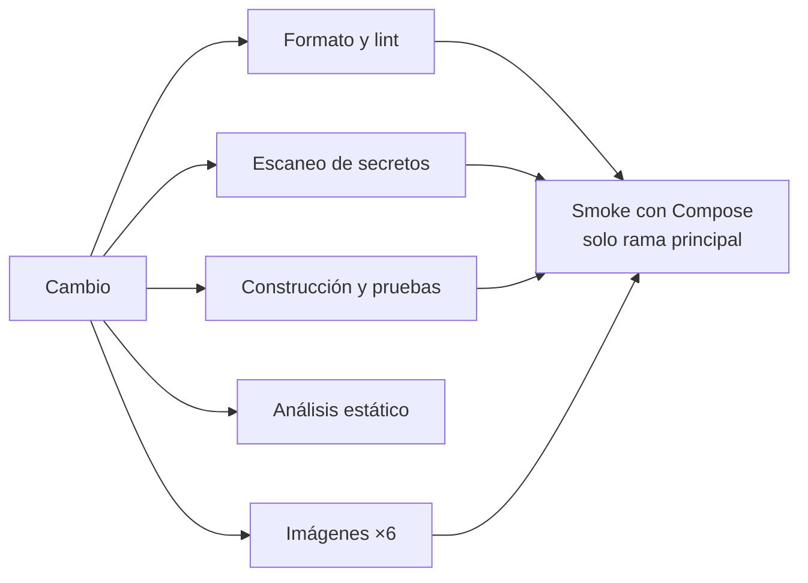

# Pipeline de integración continua de ColdGuard

El pipeline de integración continua (CI) verifica automáticamente cada cambio antes de integrarlo a
la rama principal. Está implementado con GitHub Actions y hace cumplir los criterios de calidad del
proyecto: compilación con Java 25, formato, pruebas unitarias y de integración, análisis estático,
ausencia de secretos, imágenes de contenedor construibles y un recorrido de extremo a extremo con
Docker Compose.

## 1. Cuándo se ejecuta

| Evento | Qué corre |
|---|---|
| Solicitud de integración (pull request) | Formato y lint, escaneo de secretos, construcción y pruebas, análisis estático y construcción de las seis imágenes |
| Integración a la rama principal | Todo lo anterior, más el recorrido de extremo a extremo (smoke) con Docker Compose |
| Ejecución manual | Igual que en la rama principal |

Una ejecución nueva sobre la misma solicitud cancela la anterior; sobre la rama principal nunca se
cancela. Los permisos del flujo son de solo lectura y no necesita ningún secreto: las pruebas usan las
credenciales de desarrollo del entorno local.

## 2. Etapas y criterios de calidad

| Etapa | Qué verifica | Herramienta (versión fijada) |
|---|---|---|
| Formato y lint | Formato Java; sintaxis y tipos de los flujos de trabajo; buenas prácticas en los Dockerfile; errores en los scripts de shell | Spotless con google-java-format; actionlint 1.7.7; hadolint 2.12.0; shellcheck 0.10.0 |
| Escaneo de secretos | Credenciales en todo el historial de Git, no solo en el último cambio | gitleaks 8.21.2 |
| Construcción y pruebas | Compilación con Java 25 (Temurin) de los siete módulos; pruebas unitarias, de integración (PostgreSQL, RabbitMQ y mTLS reales con contenedores de prueba) y de contrato; resumen por módulo y reportes como artefacto | Maven, JUnit 5, Testcontainers |
| Análisis estático | Defectos de código en los siete módulos | SpotBugs 4.9.8.2, umbral Medio |
| Imágenes | Las seis imágenes (cinco servicios y el simulador) se construyen y arrancan un entorno Java 25. En CI nunca se publican | Docker |
| Smoke con Compose | Se levanta toda la plataforma desde cero, se siembran datos de demostración y se recorre el flujo completo: login por rol, lectura fuera de rango, incidente, reconocimiento, escalamiento, correo, cierre, auditoría y métricas (13 comprobaciones) | Docker Compose y scripts del proyecto |

Las herramientas externas se ejecutan como imágenes de contenedor con versión fija y las acciones de
GitHub se fijan por el hash de su commit, para que un cambio ajeno al proyecto no altere el resultado.

### Excepciones documentadas

Cada excepción es acotada y tiene una razón; ninguna desactiva un control completo.

| Control | Excepción | Razón |
|---|---|---|
| hadolint | No exige fijar la versión de `curl` instalado desde el sistema base | La versión del repositorio del sistema cambia con cada actualización y rompería la construcción |
| SpotBugs | Patrones de exposición de representación interna al recibir colaboradores por constructor | Es la inyección de dependencias de Spring: guardar la dependencia es el diseño |
| SpotBugs | Excepción lanzada desde un constructor | Los constructores validan la configuración y fallan al arrancar a propósito |
| SpotBugs | Clases generadas por protoc | No es código escrito a mano |
| gitleaks | Una contraseña ficticia en una prueba | La prueba verifica que esa contraseña nunca llegue a los registros |

### Interruptores de las etapas costosas

Dos variables del repositorio permiten omitir etapas sin modificar el flujo de trabajo, por ejemplo al validar solo un cambio de infraestructura:

| Variable | Etapa que controla | Comportamiento |
|---|---|---|
| `CI_RUN_TESTS` | Compilación y pruebas (unitarias e integración) | Con el valor `false` se omite; sin definir, o con cualquier otro valor, se ejecuta |
| `CI_RUN_STATIC_ANALYSIS` | Análisis estático (SpotBugs) | Con el valor `false` se omite; sin definir, o con cualquier otro valor, se ejecuta |

Una etapa omitida aparece como "Skipped" y no bloquea la fusión ni la publicación de imágenes; una etapa que se ejecuta y falla sí las bloquea. El valor por omisión es ejecutarlo todo, de modo que olvidar la variable nunca debilita el control. El formato, los linters, el análisis de secretos y la construcción de imágenes no tienen interruptor.

## 3. Análisis de dependencias

Dependabot propone cada semana actualizaciones de las dependencias Maven, de las acciones de GitHub y
de las imágenes base de los seis Dockerfile. Se descartó OWASP Dependency-Check porque exige una clave
de la base de vulnerabilidades NVD y alarga mucho la ejecución.

## 4. Cómo reproducir cada control en una máquina local

| Control | Comando |
|---|---|
| Formato | `mvn spotless:check` (corrige con `mvn spotless:apply`) |
| Construcción y pruebas | Generar los certificados de desarrollo y ejecutar `mvn verify` |
| Análisis estático | `mvn package` seguido del objetivo `check` de SpotBugs con el filtro de exclusiones del proyecto |
| Flujos, Dockerfile y scripts | actionlint, hadolint y shellcheck en sus imágenes de contenedor |
| Secretos | gitleaks en su imagen, sobre el repositorio |
| Smoke | Arrancar la plataforma, sembrar datos y ejecutar el script de smoke |

## 5. Resultados verificados

Los controles se ejecutaron primero en local, el 2 de noviembre de 2026, sobre una copia limpia de la
rama principal (equivalente a un checkout de CI) y con las mismas versiones de herramientas que usa el
flujo; después se confirmaron en GitHub Actions.

| Control | Resultado |
|---|---|
| Construcción y pruebas | Correcto: **740 pruebas, 0 fallos, 0 errores**, siete módulos, 8 min 15 s |
| Análisis estático | Correcto: **0 hallazgos** en los siete módulos, 1 min 32 s |
| Smoke con Compose desde cero | Correcto: plataforma arriba en **111 s** y **13 de 13 comprobaciones** superadas |
| actionlint, hadolint, shellcheck | Correcto: 0 hallazgos sobre el flujo, los seis Dockerfile y los 12 scripts |
| gitleaks | Correcto: 0 hallazgos en 45 commits |

### Ejecución en GitHub Actions

La solicitud de integración n.º 70 ejecutó el pipeline en GitHub Actions el 2 de noviembre de 2026
(ejecución 41538907530, <https://github.com/marcomiler/coldguard-platform/actions/runs/41538907530>).
Los diez trabajos que corresponden a una solicitud de integración terminaron en verde:

| Trabajo | Resultado | Duración |
|---|---|---|
| Formato y lint | Correcto | 26 s |
| Escaneo de secretos | Correcto | 9 s |
| Construcción y pruebas | Correcto | 10 min 34 s |
| Análisis estático (SpotBugs) | Correcto | 2 min |
| Imagen gateway | Correcto | 52 s |
| Imagen asset-service | Correcto | 49 s |
| Imagen telemetry-service | Correcto | 51 s |
| Imagen incident-service | Correcto | 1 min 5 s |
| Imagen notification-service | Correcto | 50 s |
| Imagen sensor-simulator | Correcto | 45 s |
| Smoke con Compose | Omitido a propósito: solo corre al integrar a la rama principal o bajo demanda | — |

### Ejecución sobre la rama principal, con el smoke completo

Tras integrar la solicitud n.º 88 a la rama principal, el pipeline completo se ejecutó el 3 de
noviembre de 2026 (ejecución 41554240614,
<https://github.com/marcomiler/coldguard-platform/actions/runs/41554240614>) y los once trabajos
terminaron en verde, incluido el recorrido de extremo a extremo en un runner limpio de GitHub:

| Trabajo | Resultado | Duración |
|---|---|---|
| Formato y lint | Correcto | 25 s |
| Escaneo de secretos | Correcto | 9 s |
| Construcción y pruebas | Correcto | 8 min 3 s |
| Análisis estático (SpotBugs) | Correcto | 1 min 56 s |
| Imágenes (seis) | Correcto | 43 s a 1 min 3 s |
| **Smoke con Compose** | **Correcto** | **2 min 55 s** |

El smoke generó una contraseña temporal para los usuarios de demostración, levantó la plataforma desde
cero, sembró los datos, superó las 13 comprobaciones y destruyó el stack con sus volúmenes.

### Pruebas de que los controles detienen un cambio defectuoso

Se introdujeron fallos a propósito y se comprobó que cada control los detecta:

| Fallo introducido | Control | Resultado |
|---|---|---|
| Un `import` mal formateado en un archivo Java | Spotless | Falla: «The following files had format violations» |
| Credenciales ficticias de tipo AWS en un archivo | gitleaks | Falla: «leaks found: 2» |
| Compose sin archivo de variables de entorno | Validación de Compose | Falla: «required variable DEMO_USERS_PASSWORD is missing a value»; el flujo copia primero el archivo de ejemplo |

### Defectos reales que el pipeline destapó y se corrigieron

La verificación sobre una copia limpia y las primeras ejecuciones en GitHub encontraron seis problemas
que no se veían en la máquina de desarrollo:

1. **La integración continua anterior fallaba en un checkout limpio.** Las pruebas del Gateway abren
   canales mTLS con certificados de desarrollo que no se versionan; en una máquina limpia 50 pruebas
   fallaban. El flujo ahora genera los certificados antes de las pruebas. Con ellos, el resultado es
   740 pruebas en verde.
2. **Un script con expansión sin comillas.** shellcheck marcó un uso inseguro de una sustitución de
   comandos en el script de arranque; se corrigió con una lectura segura a un arreglo y el script se
   revalidó.
3. **Falso positivo de secretos.** gitleaks marcó la contraseña ficticia de una prueba; se acotó una
   excepción a ese archivo y esa regla.
4. **Ruido de análisis estático.** SpotBugs reportaba cientos de hallazgos (177 en un solo módulo), casi todos en clases generadas por
   protoc y en la inyección por constructor de Spring. Tras las exclusiones documentadas, quedan 0 sin
   haber ocultado código escrito a mano.
5. **El smoke fallaba en el primer intento en GitHub.** El flujo copiaba el archivo de ejemplo de
   variables, cuyos valores están vacíos, y Compose exige la contraseña de los usuarios de demostración.
   Se corrigió generándola al vuelo en el entorno del trabajo (nunca en el repositorio) y deteniendo el
   stack con el script del proyecto.
6. **Una prueba de mensajería intermitente.** Una ejecución sobre la rama principal falló porque una
   prueba de integración de RabbitMQ esperaba exactamente un efecto y contó dos. No se reprodujo en seis
   ejecuciones locales seguidas ni en otras cuatro de GitHub. El paso que la repetía se acotó a las
   pruebas etiquetadas como de integración (10 pruebas en 12 s en lugar de 168 en 193 s), y la
   estabilización de la propia prueba queda registrada como cambio aparte.

## 6. Protección de la rama principal y límites

La rama principal está protegida con un conjunto de reglas de GitHub activo y sin excepciones: no se
puede borrar ni forzar, todo cambio entra por solicitud de integración y deben pasar los diez controles
descritos (formato y lint, secretos, construcción y pruebas, análisis estático y las seis imágenes). No
se exigen aprobaciones de otra persona porque el equipo es pequeño y GitHub no permite aprobar la propia
solicitud; el control lo hacen los diez controles automáticos.

- El smoke con Compose solo corre en la rama principal y bajo demanda, porque construye las seis
  imágenes y levanta toda la plataforma; por eso no es un control obligatorio de la solicitud.
- Las imágenes no se publican desde CI; su publicación forma parte del flujo de despliegue.
- Una prueba de integración de mensajería es intermitente en runners cargados (sección 5); está
  identificada y su estabilización se tramita como cambio aparte.
