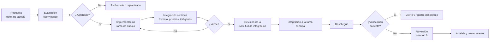

# Gestión de cambios de ColdGuard

Este documento define cómo se propone, evalúa, aprueba, implementa, verifica y, si hace falta,
revierte un cambio en la plataforma ColdGuard. Se apoya en las herramientas que el equipo ya usa:
ramas de trabajo y solicitudes de integración (pull requests) en GitHub, el pipeline de integración
continua y, para la nube, el plan de Terraform revisado antes de aplicarse.

## 1. Alcance y relación con otros procesos

Un **cambio** es toda modificación del código, de los contratos (gRPC y esquemas de eventos), de las
migraciones de base de datos, de la configuración desplegada o de la infraestructura. Se distingue de:

- **Solicitud de servicio**: pedido estándar del catálogo (alta de usuario, calibración, respaldo).
  No modifica la plataforma, solo la usa. Si una solicitud exige tocar código o infraestructura, se
  tramita como cambio.
- **Incidente**: desviación o interrupción del servicio, con prioridad P1 a P4. Corregirlo puede
  requerir un cambio de emergencia (sección 2).

## 2. Tipos de cambio

| Tipo | Ejemplos | Aprobación | Registro |
|---|---|---|---|
| Estándar | Ajuste de un tablero, documentación, dependencia menor con integración continua en verde | Revisión de la solicitud de integración (una aprobación, o autorrevisión documentada si el equipo es de una persona) | Solicitud de integración |
| Normal | Nueva funcionalidad, migración de base de datos, cambio de contrato gRPC o de evento, cambio de configuración de seguridad | Revisión de la solicitud de integración más la lista de riesgo (sección 3) y, si es arquitectónico, una decisión de arquitectura registrada | Ticket de cambio y solicitud de integración |
| Emergencia | Corrección urgente de un incidente en el entorno en ejecución | Aprobación posterior, registrada en un máximo de 24 horas | Ticket de cambio retroactivo y análisis posterior al incidente |
| Infraestructura | Cualquier creación, modificación o destrucción de recursos en la nube (`apply`, `destroy`, `import` de Terraform) | **Aprobación humana explícita previa**, con el plan de Terraform revisado y adjunto | Ticket de cambio, plan revisado y entorno protegido |

Reglas que valen para todos los tipos: los commits solo se crean a petición del autor; no se omiten
los controles automáticos (`--no-verify`); nunca se versionan secretos, estado de Terraform ni
credenciales; los cambios de arquitectura requieren una decisión registrada antes de implementarse.

## 3. Evaluación de riesgo e impacto

Antes de aprobar un cambio Normal o de Infraestructura se responde esta lista. Cada «sí» se anota
en el ticket con su mitigación.

| Pregunta | Qué se revisa |
|---|---|
| ¿Modifica datos o esquemas? | Migración reversible o compensable; respaldo previo |
| ¿Cambia un contrato gRPC o un evento? | Versionado explícito; compatibilidad con consumidores existentes |
| ¿Afecta autenticación, autorización o secretos? | Revisión de seguridad; sin secretos en el repositorio |
| ¿Cambia la observabilidad? | Métricas, trazas y logs siguen disponibles; sin datos sensibles |
| ¿Genera costo en la nube? | Estimación y etiquetas de control de costo |
| ¿Es reversible? | Plan de reversión de la sección 6 y tiempo estimado |

**Clasificación del riesgo.** Se combina el impacto del cambio (escala bajo, medio, alto y crítico,
la misma de los incidentes) con la probabilidad de que falle (baja, media, alta). Resultado:

| Impacto \ Probabilidad | Baja | Media | Alta |
|---|---|---|---|
| Bajo | Bajo | Bajo | Medio |
| Medio | Bajo | Medio | Alto |
| Alto | Medio | Alto | Alto |
| Crítico | Alto | Alto | Alto |

Un cambio de riesgo Alto exige ensayo previo en local, plan de reversión probado y aprobación
explícita antes de integrarse.

## 4. Flujo

Los cambios de emergencia siguen el mismo recorrido con la aprobación y el registro formales
posteriores a la corrección. Los cambios de infraestructura añaden, antes del despliegue, la revisión
del plan de Terraform y la aprobación explícita de una persona.

## 5. Ventanas y congelamiento

- Los cambios Estándar y Normal se integran en cualquier momento, con el pipeline en verde.
- Los cambios de Infraestructura se aplican en una ventana acordada con quien aprueba, nunca de forma
  automática.
- **Congelamiento** (supuesto académico): desde 24 horas antes de cada entrega evaluable solo se
  admiten cambios de Emergencia y correcciones de documentación.

## 6. Plan de reversión por capa

| Capa | Cómo se revierte | Verificación |
|---|---|---|
| Aplicación y configuración | Recrear únicamente el servicio afectado con la imagen etiquetada de la versión anterior y la configuración previa. Cada imagen estable se etiqueta antes de cambiar | El servicio queda sano y el comportamiento previo se restablece |
| Base de datos | Las migraciones aplicadas no se editan: se corrige con una migración compensatoria o se restaura el respaldo por esquema | Los servicios arrancan sin migrar de nuevo y los datos coinciden con el respaldo |
| Infraestructura en la nube | Revertir el cambio de código de Terraform y revisar un nuevo plan; la destrucción de recursos solo con aprobación explícita | El plan resultante no muestra diferencias inesperadas |

**Prueba de reversión de la capa de aplicación (2 de noviembre de 2026, stack local).** Se simuló un
cambio de configuración con una imagen etiquetada como versión anterior, y se revirtió.

| Paso | Acción | Resultado observado |
|---|---|---|
| 0 | Etiquetar la imagen vigente del Gateway como `previous` | Mismo identificador de imagen (`837bb799f4d8`) bajo las dos etiquetas |
| 1 | Estado inicial: un Administrador crea un incidente técnico con un cuerpo vacío | HTTP 400: la ruta está abierta y rechaza el cuerpo inválido |
| 2 | **Cambio**: recrear solo el Gateway con la imagen `previous` y el parámetro que cierra los endpoints técnicos desactivado | Contenedor sano a los 9 s; parámetro en `false` |
| 3 | Misma petición | HTTP 403: la ruta técnica queda cerrada, el cambio tuvo efecto |
| 4 | **Reversión**: recrear solo el Gateway con la imagen y la configuración originales | Contenedor sano a los 9 s; parámetro de nuevo en `true` |
| 5 | Misma petición | HTTP 400: el comportamiento inicial se restableció |

La reversión tardó 9 segundos, no tocó ningún otro servicio ni los datos, y se verificó con la misma
petición que detectó el cambio. Es una prueba en el stack local; la reversión de la capa de
infraestructura en la nube se valida con el plan de Terraform y se completa cuando exista despliegue.

## 7. Registro de cambios

Cada cambio de tipo Normal, de Emergencia o de Infraestructura recibe un identificador `CHG-NNN`. Los
Estándar quedan registrados en su solicitud de integración. Las cinco primeras entradas se
reconstruyeron el 2 de noviembre de 2026 a partir del historial real de GitHub (registro
retroactivo); la última es el cambio de la prueba de reversión.

| ID | Fecha | Tipo | Descripción | Riesgo | Aprobación | Evidencia | Resultado |
|---|---|---|---|---|---|---|---|
| CHG-001 | 2026-10-02 | Normal | Publicación confiable de eventos con Transactional Outbox, con migración de base de datos | Alto | Equipo de desarrollo, tras la decisión de arquitectura correspondiente | Commit `fb8d8f9` | Integrado |
| CHG-002 | 2026-10-02 | Normal | Contratos gRPC versionados y esquema del evento de umbral superado | Medio | Revisión y fusión de la solicitud de integración n.º 35 | Solicitud de integración n.º 35, commits `b0fb76c` y `45332bf` | Integrado |
| CHG-003 | 2026-10-05 | Normal | Autenticación del actor en los servicios internos con identidad propagada por el Gateway | Alto | Equipo de desarrollo, tras la decisión de seguridad correspondiente | Commit `fec4558` | Integrado |
| CHG-004 | 2026-10-07 | Estándar | Tableros de Grafana aprovisionados como código | Bajo | Equipo de desarrollo | Commit `3c3f3b4` | Integrado |
| CHG-005 | 2026-10-05 | Estándar | Corrección de un defecto: cerrar un incidente con un identificador que no es un UUID debe responder 404 | Bajo | Equipo de desarrollo | Commit `93dba01` | Integrado |
| CHG-006 | 2026-11-02 | Estándar | Prueba controlada de reversión del Gateway en el stack local (sección 6) | Bajo | Equipo de desarrollo | Tabla de la sección 6 | Cambio revertido; comportamiento restablecido |

## 8. Métricas del proceso

| Métrica | Definición | Valor a la fecha |
|---|---|---|
| Cambios registrados | Cambios con identificador `CHG-NNN` | 6 entre el 2 de octubre y el 2 de noviembre de 2026 (cinco retroactivos y uno nuevo) |
| Cambios que corrigen un defecto | Cambios registrados cuyo objetivo es una corrección | 1 de 6 (CHG-005) |
| Tiempo de reversión | Duración de la reversión de la capa de aplicación | 9 segundos en la prueba local (CHG-006) |
| Tasa de cambios revertidos | Cambios que requirieron reversión por una falla | 0 de 6; la reversión de CHG-006 fue una prueba, no una falla |
| Tiempo de entrega de un cambio | Desde la propuesta hasta el despliegue | No medido: no hay tickets de cambio anteriores a este proceso |

Las métricas se calculan con datos reales; cuando no hay dato se declara «no medido».

## 9. Plantillas

El proceso usa dos plantillas de GitHub: una de **ticket de cambio** (tipo, riesgo, plan de reversión,
aprobador y ventana) y una de **solicitud de integración** (pruebas, formato, ausencia de secretos,
decisión de arquitectura si aplica, documentación y plan de reversión).
