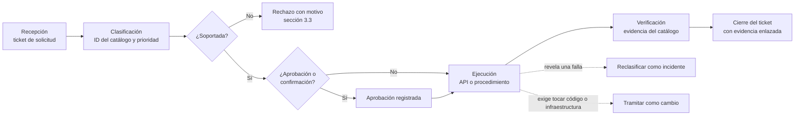

# Catálogo de solicitudes de servicio de ColdGuard

Este documento define qué puede pedir cada actor a la plataforma ColdGuard, quién lo atiende, con
qué prioridad y plazo objetivo, y qué evidencia deja cada solicitud. Aplica al entorno de ejecución
real del proyecto, el stack local con Docker Compose; el entorno en Azure hereda el mismo catálogo
cuando se aprovisione.

## 1. Solicitud, incidente y cambio

| Concepto | Qué es | Cómo se gestiona |
|---|---|---|
| Solicitud de servicio | Pedido estándar, conocido y planificable: alta, cambio de configuración, consulta o tarea operativa | Este catálogo |
| Incidente | Desviación del producto o interrupción del servicio; prioridad P1 a P4 según impacto por urgencia (RN-012) | Proceso de incidentes y SLA por prioridad |
| Cambio | Modificación del código, de los contratos, de los datos de la plataforma o de la infraestructura | Gestión de cambios (sección 8.2 del informe) |

Una solicitud que revela una falla se reclasifica como incidente. Una que exige modificar código,
contratos o infraestructura se tramita como cambio.

## 2. Prioridad y plazos objetivo (supuesto académico)

La prioridad de una solicitud no se calcula con la matriz de impacto por urgencia de los incidentes.
Se asigna según cuánto bloquea la operación y usa solo los niveles P2 a P4.

| Prioridad | Criterio | Plazo objetivo de atención |
|---|---|---|
| P2 | Bloquea la operación (sin acceso, sensor sin operar) | 1 día hábil |
| P3 | Afecta una función, pero existe alternativa | 3 días hábiles |
| P4 | Planificable o consulta | 5 días hábiles |

## 3. Catálogo

Los roles son los cinco actores del proyecto: Administrador de plataforma (`PLATFORM_ADMIN`),
Supervisor de operaciones (`OPERATIONS_SUPERVISOR`), Operador, Técnico de mantenimiento y Auditor.
No se definen otros. En las solicitudes por API, el actor ejecuta la acción con su propio rol y el
Gateway aplica control de acceso por rol con rechazo por defecto. Todas las rutas cuelgan de
`/api/v1`.

### 3.1 Solicitudes atendidas por la API

| ID | Solicitud | Rol que la ejecuta | Operación | CU | Prioridad | Aprobación | Evidencia que deja |
|---|---|---|---|---|---|---|---|
| SR-001 | Alta o edición de organización, sede o activo | Administrador de plataforma | `POST`, `PUT`, `PATCH` en `/organizations`, `/sites`, `/assets` | CU-001, CU-012, CU-013 | P3 | No requerida | Registro en la bitácora de auditoría |
| SR-002 | Alta o edición de sensor y de su perfil operativo | Administrador de plataforma | `POST`, `PUT`, `PATCH` en `/sensors` y `/sensors/{id}/profile` | CU-007, CU-011, CU-013 | P3 | No requerida | Bitácora |
| SR-003 | Cambio de estado operativo del sensor | Administrador de plataforma | `POST /sensors/{id}/status` | CU-017 | P2 | No requerida | Bitácora y evento `SensorStatusChanged` |
| SR-004 | Registro de calibración o verificación | Administrador de plataforma | `POST /sensors/{id}/calibrations` | CU-019 | P3 | No requerida | Bitácora y evento `SensorCalibrationRecorded` |
| SR-005 | Reasignación de un sensor a otro activo (el sensor debe estar en mantenimiento) | Administrador de plataforma | `POST /sensors/{id}/reassignment` | CU-018 | P3 | No requerida | Bitácora y evento `SensorReassigned` |
| SR-006 | Retiro lógico de un sensor | Administrador de plataforma | `POST /sensors/{id}/retirement` | CU-020 | P4 | No requerida | Bitácora y evento `SensorRetired` |
| SR-007 | Alta de usuario | Administrador de plataforma | `POST /users` | CU-014 | P2 | No requerida | Bitácora (`USER_CREATED`) |
| SR-008 | Asignar o revocar un rol | Administrador de plataforma | `POST` y `DELETE /users/{id}/roles` | CU-014 | P2 | Motivo obligatorio, queda auditado | Bitácora con motivo |
| SR-009 | Habilitar o deshabilitar un usuario | Administrador de plataforma | `POST /users/{id}/enabled` | CU-014 | P2 | Motivo obligatorio, queda auditado | Bitácora con motivo |
| SR-010 | Reprocesar la evaluación de lecturas de prueba | Administrador de plataforma | `POST /telemetry/test-readings` | CU-015 | P4 | No requerida | Resultado de la evaluación e incidente si se supera un umbral |
| SR-011 | Consulta del historial de un sensor | Administrador de plataforma | `GET /sensors/{id}/history` | CU-021 | P4 | No requerida | Respuesta de la consulta |
| SR-012 | Consulta de métricas operativas de incidentes | Supervisor de operaciones | `GET /metrics/incidents` | CU-008 | P4 | No requerida | Respuesta de la consulta |
| SR-013 | Consulta de la bitácora de auditoría (exige el parámetro `from`) | Auditor | `GET /audit-records` | CU-009 | P4 | No requerida | Respuesta de la consulta |

Que no se requiera aprobación formal no significa que no haya control. Las operaciones que
modifican datos las audita el módulo propietario (RN-008), y el último administrador habilitado no
puede perder su rol ni ser deshabilitado.

### 3.2 Solicitudes operativas

Las atiende el Administrador de plataforma con los procedimientos operativos del stack; no tienen
ruta de negocio.

| ID | Solicitud | Procedimiento | Prioridad | Aprobación o confirmación | Evidencia que deja |
|---|---|---|---|---|---|
| SR-014 | Arranque o parada del stack | Script de arranque (espera a que todos los contenedores con comprobación de salud estén sanos) y script de parada | P3 | No requerida | Salida del script con los contenedores sanos |
| SR-015 | Respaldo de los datos de negocio | Script de respaldo: un volcado `pg_dump` por esquema, solo lectura | P3 | No requerida | Un archivo `.sql` por esquema en una carpeta con marca de tiempo |
| SR-016 | Regeneración de certificados y claves de firma de tokens | Script de generación de certificados de desarrollo | P3 | Confirmar que invalida los tokens emitidos | Salida del script y reinicio del stack |
| SR-017 | Reprocesar mensajes de una cola de mensajes fallidos (DLQ) | Mover los mensajes desde la consola de RabbitMQ tras corregir la causa | P2 | Registrar la causa corregida | Profundidad de la DLQ en el tablero de mensajería |
| SR-018 | Restablecer el entorno de demostración | Script de reinicio: borra todos los volúmenes, levanta el stack y siembra datos | P4 | Destructiva: exige un respaldo previo (SR-015) y confirmación | Salida del script y nuevo conjunto de datos sembrados |

### 3.3 Solicitudes no soportadas en el MVP

Se listan para no prometer capacidades que el sistema no tiene.

| Solicitud | Motivo |
|---|---|
| Baja o eliminación de organización, sede o activo | El Gateway no expone la operación de borrado para esos recursos |
| Cambio de contraseña por la API | No implementado; en local solo se resuelve borrando los datos |
| Acción del Operador sobre un incidente (aportar contexto) | No existe requisito, caso de uso ni evento que la respalde |
| Acceso a Grafana por solicitud y rol | No hay roles ni usuarios definidos para Grafana |
| Envío de correos reales y solicitudes en Azure | Azure está planificado, no aprovisionado; en local las notificaciones llegan a un buzón de pruebas |

## 4. Flujo de atención



Estados del ticket: Recibida, Clasificada, En ejecución, Verificada y Cerrada (o Rechazada). Cada
ticket registra el ID del catálogo, el rol solicitante, el entorno, la prioridad propuesta, la
justificación, la aprobación si aplica y el enlace a la evidencia. No debe contener contraseñas,
tokens ni datos personales.

## 5. Matriz RACI

R: ejecuta. A: responde del resultado. C: consultado. I: informado.

| Solicitud | Solicitante | Administrador de plataforma | Supervisor de operaciones | Auditor |
|---|---|---|---|---|
| SR-001 a SR-011 | I | R/A | I | I (ve el rastro en la bitácora) |
| SR-012 | R/A | C | — | — |
| SR-013 | — | I | — | R/A |
| SR-014 a SR-018 | C | R/A | I | I |

El solicitante de SR-001 a SR-011 y de SR-014 a SR-018 es cualquier actor que necesite el cambio
(por ejemplo, el Supervisor pide un sensor nuevo); lo ejecuta el Administrador de plataforma. Si el
solicitante es el propio administrador, el ticket recoge su justificación y la bitácora deja el
rastro.

## 6. Medición

| Indicador | Cómo se obtiene | Observación |
|---|---|---|
| Volumen de solicitudes por tipo | Conteo de tickets por ID de catálogo | Disponible al cerrar tickets |
| Cumplimiento del plazo objetivo | Fecha de cierre menos fecha de recepción, frente a la sección 2 | Se compara con el supuesto académico; no es un SLA |
| Operaciones de administración ejecutadas | Registros de la bitácora de auditoría por acción | Disponible en la API |

## 7. Evidencia de ejecución

El 2 de noviembre de 2026 se ejecutaron tres solicitudes de punta a punta en el stack local
(Docker Compose, seis servicios sanos, datos de demostración sembrados). Los datos son ficticios.

### SR-007: alta de usuario

Un Administrador de plataforma creó el usuario `evidencia.sr007` con el rol Operador. La API
respondió con el usuario habilitado y sin devolver la contraseña:

```json
{"userId":"eba54e59-6008-4784-8dc6-4d84039e57a9","username":"evidencia.sr007",
 "displayName":"Usuario evidencia SR-007","roles":["OPERATOR"],"enabled":true,
 "createdAt":"2026-11-02T21:31:54.395915079Z"}
```

### SR-004: registro de calibración

El mismo administrador registró una calibración del sensor `SN-VAC-001`. La API respondió `201` y
calculó la vigencia a partir del perfil del sensor, sin que el solicitante la indicara:

```json
{"id":"9f6f8796-4329-4e8f-917c-6fe815530ddc","sensorId":"d5ec1974-0b1f-4901-b375-620977b226af",
 "kind":"CALIBRATION","performedAt":"2026-11-02T21:31:54Z","validUntil":"2027-01-31T21:31:54Z",
 "recordedAt":"2026-11-02T21:31:54.440721129Z","reason":"Calibracion periodica de evidencia SR-004"}
```

### SR-015: respaldo de datos

El script de respaldo generó un volcado por esquema, con los tamaños siguientes:

| Esquema | Tamaño del volcado |
|---|---|
| `asset` | 62 860 bytes |
| `telemetry` | 4 097 976 bytes |
| `incident` | 271 943 bytes |
| `identity` | 5 264 bytes |
| `auditlog` | 602 160 bytes |
| `notification` | 10 875 bytes |

### Rastro en la bitácora de auditoría

Un Auditor consultó la bitácora (`GET /audit-records` con el parámetro `from`) y vio las dos
operaciones de administración, con el actor, la fecha y, en la calibración, el motivo y la vigencia:

| Acción | Entidad | Momento (UTC) | Actor |
|---|---|---|---|
| `USER_CREATED` | Cuenta de usuario | 2026-11-02 21:31:54.395 | Administrador de plataforma |
| `SENSOR_CALIBRATION_RECORDED` | Sensor | 2026-11-02 21:31:54.440 | Administrador de plataforma |

| Solicitud | Fecha | Resultado | Evidencia |
|---|---|---|---|
| SR-007 | 2026-11-02 | Usuario creado | Respuesta de la API y registro `USER_CREATED` |
| SR-004 | 2026-11-02 | Calibración registrada, `201` | Respuesta de la API y registro `SENSOR_CALIBRATION_RECORDED` |
| SR-015 | 2026-11-02 | Seis volcados generados | Tabla de tamaños |

Las dos ejecuciones por API se atendieron en menos de un segundo, dentro del plazo objetivo de la
prioridad correspondiente.
